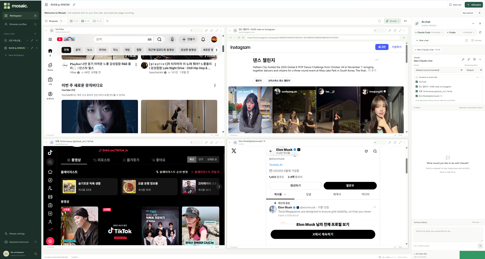

# Mosaic

**Your web pages and AI, side by side.**

[Download for Windows](https://github.com/Inkee1/mosaic/releases/tag/v0.7.5) · [한국어](docs/distribution/README.ko.md) · [Getting started](docs/distribution/quickstart.en.md) · [Report an issue](https://github.com/Inkee1/mosaic/issues)

Mosaic is a Windows desktop browser that brings multiple web pages and AI conversations into one workspace. Compare content, research across sites, and keep separate accounts in each pane. Choose which pages Claude Code or Codex can work with.



*Four websites and an AI chat panel in one workspace. The app supports English and Korean. Login IDs have been removed from this screenshot.*

## What you can do

- **See pages side by side.** Arrange web panes in a grid and save their addresses and layout as workspaces.
- **Keep accounts separate.** Use different browser profiles and sign-in sessions for different panes.
- **Work with AI on selected pages.** Choose the panes a Claude Code or Codex chat can access. Stop the AI or take over when needed.
- **Use the built-in browser or connect Chrome.** Switch to a separate Chrome connection for sites that need it.
- **Choose English or Korean.** Change the interface under **Mosaic settings → Language**. Your writing and website content stay in their original language.

AI features require your own supported CLI installation and provider account; provider pricing and limits apply. Website compatibility varies, and a finished AI response does not confirm that a website task succeeded.

## Install

**Mosaic 0.7.5 is an unsigned Windows x64 beta.** Windows may show an unknown-publisher or SmartScreen warning. Download from the official release and compare the included SHA-256 checksums before running. See the [installation guide](docs/distribution/quickstart.en.md#install-and-start) for details.

- [Installer — Mosaic-0.7.5-win-x64-setup.exe](https://github.com/Inkee1/mosaic/releases/download/v0.7.5/Mosaic-0.7.5-win-x64-setup.exe)
- [ZIP — Mosaic-0.7.5-win-x64-portable.zip](https://github.com/Inkee1/mosaic/releases/download/v0.7.5/Mosaic-0.7.5-win-x64-portable.zip): extract the entire archive and run `Mosaic.exe`.

Save your work and close Mosaic before updating. Both formats keep user data in `%APPDATA%\MosaicBrowser`; uninstalling preserves it.

## Get started

1. Add a pane and open a website. Sign in directly on the site if needed.
2. Install and sign in to the official Claude Code or Codex CLI with your own account.
3. Create an AI chat, choose its provider and allowed panes, and describe your task.

See the [English guide](docs/distribution/quickstart.en.md) or [한국어 시작하기](docs/distribution/setup.md) for setup, privacy, permissions and troubleshooting.

## Privacy and usage counting

Local activity counts and online usage counting are both **off by default**. Online counting requires separate consent and measures active installations, not verified individual people. It sends a random installation ID, app/platform information and one activity event per UTC day; browsing history, page contents, chats, accounts and passwords are not included.

During an AI task, selected page content and screenshots may be sent to your chosen AI provider. Read [Data and privacy](docs/distribution/quickstart.en.md#data-and-privacy) for storage, retention and opt-out details.

## Feedback and support

Found a bug or have an idea? [Open a GitHub issue](https://github.com/Inkee1/mosaic/issues). Include the Mosaic version and steps to reproduce it. For private or security-related reports, email **tensordev9@gmail.com**; see [SECURITY.md](SECURITY.md).

## Develop and verify

Use Node.js 24 and npm on Windows x64 for desktop builds and integration tests.

```powershell
npm ci
npx playwright install chrome
npm run dev             # Preview the web UI
npm run desktop         # Build and launch the desktop app
npm run test:core
npm run test:e2e
npm run test:desktop
```

The web preview does not provide native browser sessions or desktop AI features. Automated tests use isolated profiles, local test sites and test AI providers.

```powershell
npm run dist:win        # App folder, installer, ZIP and SHA-256 checksums
npm run audit:publication
npm run export:source
npm run check:release:public
```

The public release check validates release configuration, licensing, analytics configuration, file integrity and signing policy. Unsigned builds are allowed only under the explicit beta policy; the stable channel requires verified signing. The [0.7.5 release workflow](https://github.com/Inkee1/mosaic/actions/runs/43428245275) passed 212 core, 69 UI and 15 packaged-app tests, plus installation, reinstallation and uninstall checks.

Further documentation (Korean): [Contributing](docs/distribution/contributing.md) · [Troubleshooting](docs/distribution/troubleshooting.md) · [Release process](docs/distribution/release.md) · [Validation](docs/distribution/validation.md) · [Third-party notices](docs/distribution/third-party-notices.md).

## License

Mosaic's own code is available under [PolyForm Noncommercial 1.0.0](LICENSE.md). Use, modification and redistribution are permitted for noncommercial purposes under its terms. Commercial use, including modification for commercial purposes, requires separate permission. This is source-available software under a noncommercial license, not an OSI open-source license. Third-party components retain their own licenses.
