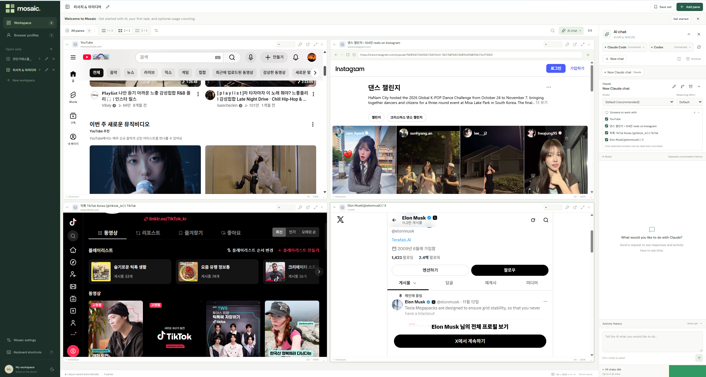

# Mosaic

[English](../../README.md) · **한국어** · [Windows 다운로드](https://github.com/Inkee1/mosaic/releases/tag/v0.7.5)

**여러 웹페이지와 AI를 한 화면에서. 화면마다 다른 계정으로, 필요한 작업을 나란히.**

Mosaic는 여러 웹 화면과 AI 채팅을 한 작업 공간에서 사용하는 Windows 데스크톱 브라우저입니다. 자료 조사, 콘텐츠 비교, 여러 계정의 작업을 나란히 보고, 선택한 화면에서 Claude Code 또는 Codex와 함께 작업할 수 있습니다.



*YouTube, Instagram, TikTok, X를 나란히 배치하고 오른쪽에서 AI와 작업하는 예시입니다. 공개용 이미지에서 로그인 ID만 가렸습니다.*

**0.7.5 미서명 베타.** 공식 소스와 배포 파일은 [Inkee1/mosaic](https://github.com/Inkee1/mosaic)의 [Releases](https://github.com/Inkee1/mosaic/releases)에서 확인하세요. Windows가 알 수 없는 게시자 경고를 표시할 수 있습니다. 문의: tensordev9@gmail.com

## 할 수 있는 일

- 여러 웹 화면을 격자로 배치하고, 작업 세트별로 주소와 배치를 보관합니다.
- 화면마다 별도 로그인 상태를 유지하고, 프로필별로 계정을 관리합니다.
- 선택한 화면에서 AI 채팅을 실행·중지·이어갑니다. 내장 브라우저와 별도 Chrome 연결을 지원합니다.
- 첫 실행 안내와 설정 화면에서 AI 연결 상태, 수동 업데이트, 진단 요약을 확인합니다.
- 시스템 언어에 따라 한국어·영어로 시작하며, **Mosaic 설정 → 언어**에서 변경할 수 있습니다. 직접 작성한 이름·내용과 웹사이트 언어는 바꾸지 않습니다.

AI 응답이 끝났다는 표시는 사이트의 실제 작업 성공을 보증하지 않습니다. 로그인·인증과 중요한 변경 결과는 사이트에서 직접 확인하세요. 일부 사이트는 내장 브라우저를 지원하지 않을 수 있습니다.

## 설치와 첫 사용

설치판은 `Mosaic-0.7.5-win-x64-setup.exe`, 압축판은 `Mosaic-0.7.5-win-x64-portable.zip`입니다. 압축판은 전체를 풀고 `Mosaic.exe`를 실행합니다. 두 방식 모두 사용자 데이터는 `%APPDATA%\MosaicBrowser`에 보관하며 앱 제거 시에도 유지합니다.

AI 기능에는 공식 Claude Code 또는 Codex CLI 설치와 본인 계정 로그인이 필요합니다. 제공자의 요금·한도는 별도로 적용됩니다. 자세한 절차는 [시작하기](setup.md)를 확인하세요.

기기 내부 사용 횟수 기록과 서버 사용자 수 집계는 각각 기본적으로 꺼져 있습니다. 서버 집계는 별도 동의 후 무작위 설치 ID·앱 버전·OS와 하루 한 번 실행 여부만 보내며 과거 로컬 기록을 전송하지 않습니다. 집계 서버가 연결되지 않은 빌드는 전송하지 않습니다. AI 작업의 페이지 내용과 스크린샷은 선택한 AI 제공자에게 전달될 수 있습니다. [개인정보와 저장](privacy.md), [집계 연결](analytics.md)을 확인하세요.

## 문서

- [시작하기와 업데이트](setup.md)
- [개인정보와 저장](privacy.md)
- [문제 해결](troubleshooting.md)
- [기여와 개발](contributing.md)
- [배포 절차와 공개 전 확인](release.md)
- [0.7.5 배포 검증 결과](validation.md)
- [라이선스 결정 사항](license-policy.md)
- [타사 소프트웨어 고지](third-party-notices.md)

## 개발과 검증

Node.js 22.12 이상과 npm을 사용합니다. 데스크톱 배포·통합 검증은 Windows x64에서 실행합니다.

```powershell
npm ci
npx playwright install chrome
npm run dev             # 웹 UI 미리보기
npm run desktop         # 데스크톱 앱 빌드 후 실행
npm run test:core
npm run test:e2e
npm run test:desktop
```

웹 UI 미리보기에서는 실제 사이트 로그인과 데스크톱 AI 기능을 사용할 수 없습니다. 테스트는 격리된 임시 사용자 데이터와 로컬 사이트를 사용합니다.

```powershell
npm run dist:win         # 실행 폴더·설치형·압축형·SHA-256
npm run audit:publication
npm run export:source   # 허용 목록에 있는 파일만 소스 ZIP에 포함
npm run check:release   # 로컬 미리보기 점검
npm run check:release:public
```

`check:release:public`은 배포 정보·라이선스·집계 연결·파일 무결성과 서명 정책을 검사합니다. 미서명은 명시적으로 선택한 베타에서만 허용하며 정식 채널은 서명이 필요합니다. 배포 정보는 `release.config.json`에서 관리합니다.

## 라이선스

Mosaic 자체 코드는 [PolyForm Noncommercial 1.0.0](../../LICENSE.md)을 적용합니다. 비상업 목적의 사용·수정·재배포를 허용하며 상업적 이용과 그 목적의 수정에는 별도 허락이 필요합니다. 일반적인 영리 업무 사용도 자유롭게 허용하는 조건은 아닙니다. OSI 오픈 소스 대신 비상업 조건의 소스 공개로 안내합니다. 공익기관 등 원문의 허용 범위는 [라이선스 안내](license-policy.md)를 확인하세요. 타사 구성요소에는 각각의 원래 라이선스가 적용됩니다.
